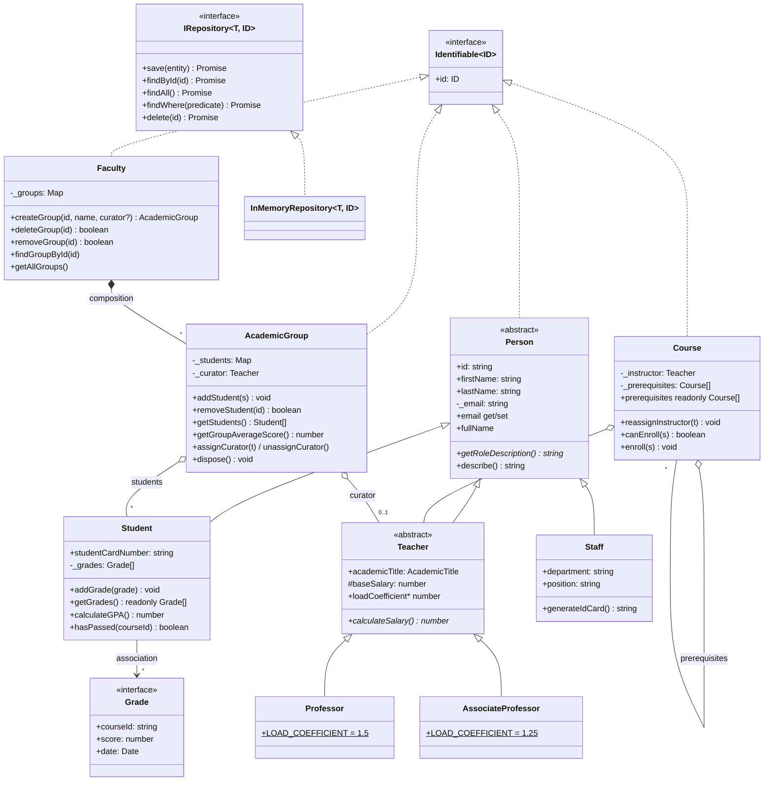

# University Management System — TypeScript OOP

Homework for **SoftServe JS/TS Session 09**: classes and access modifiers, encapsulation, abstract classes, interfaces, generics and three kinds of relationships between classes — inheritance, composition and aggregation — plus the generic repository pattern.

## How to run

You need [Node.js](https://nodejs.org/) 18 or newer.

```bash
npm install          # once: installs typescript, tsx, @types/node (dev dependencies only)
npx tsx main.ts      # the demonstration (same as: npm start)
npm run play         # interactive menu: add students, give grades, export reports...
npm run typecheck    # strict TypeScript check, no errors
npm test             # 40 automated tests (node:test)
npm run check        # typecheck + tests + demo in a row
npm run build        # compile to plain JavaScript in dist/ (shows type erasure)
npm run start:js     # run the compiled dist/main.js with plain Node
```

## Files

| File | Contents |
|------|----------|
| `basic-contracts.ts` | Contracts only: `Identifiable<ID>`, `EntityId`, `AcademicTitle`, `Grade` |
| `person-hierarchy.ts` | `Person` (abstract) → `Student`, `Teacher` (abstract) → `Professor`, `AssociateProfessor`; extension `Staff` |
| `learning-units.ts` | `Course` (aggregates a `Teacher`, extension: prerequisites), `AcademicGroup` (aggregates `Student`s and a curator) |
| `faculty.ts` | `Faculty` — creates, finds and deletes its groups (composition) |
| `repository.ts` | `IReadRepository`, `IWriteRepository`, `IRepository<T, ID>`, `InMemoryRepository<T, ID>` (with `findWhere`) |
| `main.ts` | Demonstration scenario |
| `reports.ts` | Extension 3: `ReportGenerator` (template method), `XmlReportGenerator`, `JsonReportGenerator` |
| `validation.ts` | Shared helpers: `ValidationError`, non-empty / positive checks, rounding, date formatting |
| `interactive.ts` | Optional text-menu playground with the same classes |
| `tests/university.test.ts` | Automated tests for every checklist item and extension |
| `tsconfig.json`, `tsconfig.build.json` | Strict compiler settings; the build config emits JavaScript to `dist/` |

## Architecture



| Relationship | Between | In the code |
|---|---|---|
| Inheritance (IS-A) | `Person` ← `Student`, `Teacher`, `Staff`; `Teacher` ← `Professor`, `AssociateProfessor` | `extends`, `super(...)`, `override` |
| Composition (strong HAS-A) | `Faculty` → `AcademicGroup` | only `Faculty.createGroup` does `new AcademicGroup`; `deleteGroup` / `removeGroup` ends the group's life cycle: it is disposed and refuses further changes |
| Aggregation (weak HAS-A) | `AcademicGroup` → `Student`, curator `Teacher`; `Course` → `Teacher`, prerequisite `Course`s | objects come from outside, only references are stored; removing them from the group / course does not destroy them |
| Association | `Student` → `Grade` | the student accumulates grade records; a grade points to a course by `courseId` |
| Realization | `InMemoryRepository<T>` → `IRepository<T>`; all entities → `Identifiable` | `implements` |

## Checklist

| Requirement | Where |
|---|---|
| `Identifiable`, `IRepository<T>`, `Grade` declared as contracts | `basic-contracts.ts`, `repository.ts` |
| `Person` is abstract, email validated in a setter, abstract `getRoleDescription()` | `person-hierarchy.ts` — the constructor also goes through the setter |
| `Student` keeps grades in a private array, returns them as `readonly`, computes GPA | `private readonly _grades`, `getGrades(): readonly Grade[]`, `calculateGPA()` |
| `Teacher` is abstract; `Professor` and `AssociateProfessor` calculate salary differently | abstract `loadCoefficient` and `calculateSalary()`; coefficients 1.5 and 1.25 |
| `Course` and `AcademicGroup` reference teachers/students without owning them | `learning-units.ts` |
| `Faculty` creates and deletes groups itself | `faculty.ts`: `createGroup`, `deleteGroup` (+ `removeGroup`), `findGroupById`, `findGroupByName`, `getAllGroups` |
| `InMemoryRepository<T>` implements `IRepository<T>` with all CRUD methods | `repository.ts` |
| `main.ts` runs and demonstrates all parts | parts 1–4 required, 5–9 extensions and validation |
| `readonly`, access modifiers, parameter properties | `public readonly id`, `private _email`, `protected readonly baseSalary`, `static readonly` constants |
| Extension 1 — `Staff` with department and service ID card | `Staff.generateIdCard()` |
| Extension 2 — course prerequisites | `Course.prerequisites`, `addPrerequisite / getMissingPrerequisites / canEnroll / enroll` |
| Extension 3 — reports with the template method | `reports.ts` |
| Extension 4 — `findWhere(predicate)` | `IReadRepository.findWhere` |

## Design decisions

The task leaves some points open; these are the choices made and why.

1. **`AcademicGroup`; `deleteGroup` and `removeGroup`.** The task text mentions `Group` and `removeGroup(...)`, the reference code uses `AcademicGroup` and `deleteGroup(...)`. The class is `AcademicGroup` (as in the reference). Both method names exist: `deleteGroup` holds the logic, `removeGroup` delegates to it.
2. **GPA** is the average of all scores on the 100-point scale, rounded to 2 decimals (as in the reference code); `0` for a student without grades.
3. **Group average score** is the mean GPA of the students **that have grades** — a deliberate difference from the reference code, which divides by all students. A newcomer without grades has GPA `0`; counting them would lower the average for no reason (two students with 91 and 95 plus a newcomer would give 62 instead of 93). Returns `0` if nobody has grades. Reports show both `studentCount` and `gradedStudentCount`, so it is always visible what the average is based on.
4. **Load coefficient.** `Teacher` declares two abstract members: `loadCoefficient` and `calculateSalary()`. Each subclass returns its own coefficient (`static readonly LOAD_COEFFICIENT`, 1.5 / 1.25) and calculates its salary. `baseSalary` is `protected`.
5. **Grades are protected twice.** `getGrades()` is typed `readonly Grade[]` (compile time) and returns a copy (run time); every stored grade is a frozen copy with its own `Date`, so changing the object passed to `addGrade` later changes nothing.
6. **Email** is trimmed and lower-cased by the setter, then checked against `name@domain.zone`. A failed assignment leaves the old value untouched.
7. **Invalid data** throws a dedicated `ValidationError` (score outside 0–100, `NaN`, invalid date, empty names, non-positive salary or credits, duplicate student in a group, duplicate group id or name, cyclic prerequisites).
8. **Repository** follows the reference: every method returns a `Promise`, so a database implementation could replace it without changing callers. The contract is split into `IReadRepository` + `IWriteRepository` (Interface Segregation); `IRepository` extends both. `ID` is a second type parameter with default `string`, so `InMemoryRepository<Student>` is enough, while `InMemoryRepository<Room, number>` also works. `save` is an upsert.
9. **Composition in practice.** TypeScript has no package-private constructors, so `new AcademicGroup(...)` is technically possible outside `Faculty`; by convention groups are created only through `Faculty.createGroup`. On `deleteGroup` the group is *disposed*: it drops its links to students and curator and throws on any later change, so a reference kept somewhere cannot turn into a "zombie" group. The students and the curator keep living — that is exactly the difference between composition and aggregation. `dispose()` must be public for `Faculty` to call it, and is documented as internal.
10. **Prerequisites.** A course counts as passed if the student's **best** score for it is at least 60 (retakes count). Only direct prerequisites are checked at enrolment: the prerequisites of a prerequisite were already checked when the student enrolled in it. Self-references, duplicates and cycles (also indirect ones) are rejected.
11. **Reports** rank students by GPA (equal GPA → equal rank: 1, 1, 3). The JSON header, body and footer together form one valid JSON document (verified by a test with `JSON.parse`); XML escapes `& < > " '`. JSON keeps numbers as numbers, XML prints them with 2 decimals.
12. **Reproducible output.** The demo uses fixed dates, and `generateIdCard` / `generate` accept the date as a parameter.
13. **Readonly names.** `firstName`, `lastName`, course `title`/`credits` and the group `name` are `readonly` (the reference has them mutable): a change of name is a separate process, not a silent assignment. The curator can be assigned, replaced and unassigned; `Course.prerequisites` is a read-only list changed only through `addPrerequisite`.
14. **Logging.** The reference `reassignInstructor` prints a log line from inside the model class; here the classes do not print anything and the demo prints the message, so the classes can be reused in tests or on a server.
15. **Staff ID card.** The department code takes the first three *letters* of the department in any alphabet (`Адміністрація` → `АДМ`); all dates are handled in UTC.
16. **Build.** Imports use the `.ts` extension, which `tsx` runs directly; `rewriteRelativeImportExtensions` turns them into `.js` when compiling with `npm run build`. In `dist/basic-contracts.js` only `export {};` is left: interfaces and type aliases are erased.
17. **Out of scope** (not required by the task and kept out on purpose): one student may be added to groups of different faculties; `addGrade` does not check that a course with this `courseId` exists (a grade only references the course by id, like a foreign key); there is no persistent storage.

## Example output (fragment)

```text
==============================================================================
  1. Teachers: abstract class, inheritance, polymorphism
==============================================================================
  Taras Shevchenko  Professor           salary 30,000.00 UAH
    getRoleDescription(): Professor of the department (load coefficient ×1.5)
  Olena Koval       AssociateProfessor  salary 20,000.00 UAH
...
  Grades and GPA:
    Ivan Melnyk        scores [95, 87]        GPA 91.00
    Anna Boiko         scores [98, 92]        GPA 95.00
    Maksym Lysenko     scores [55, 71]        GPA 63.00
    Sofiia Tkachenko   scores [—]             GPA 0.00

  Average score of group KN-21: 83.00
```

Run `npx tsx main.ts` to see the whole output.
