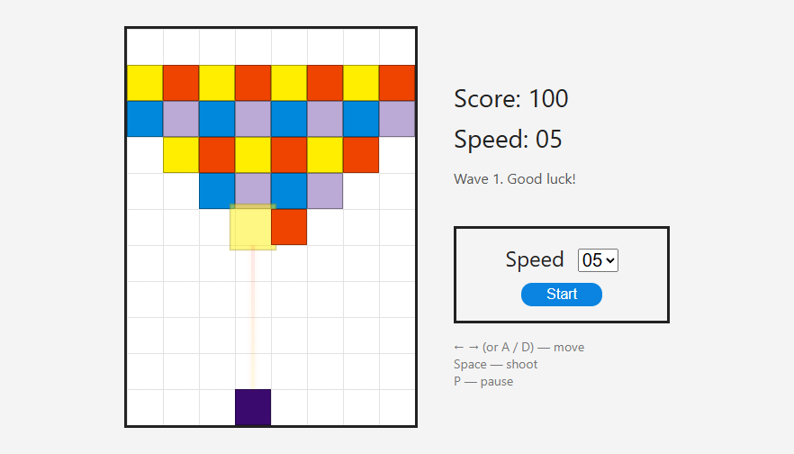
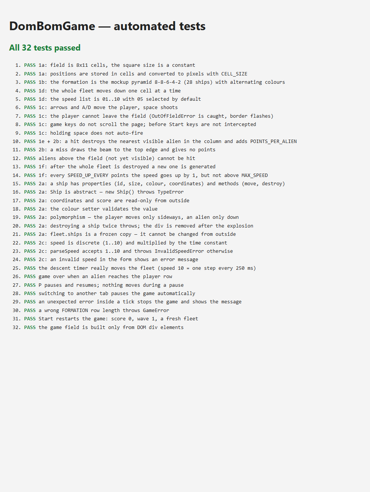
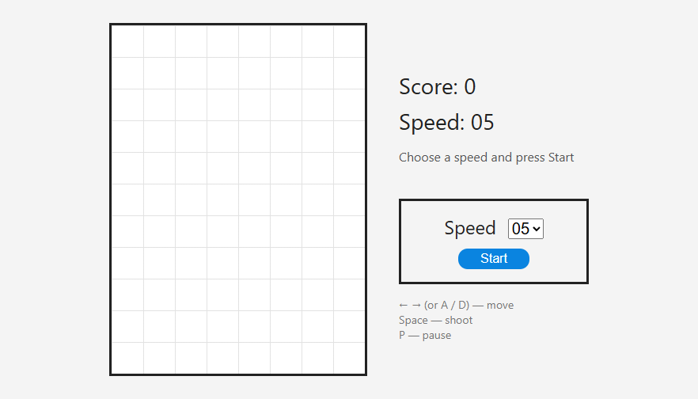
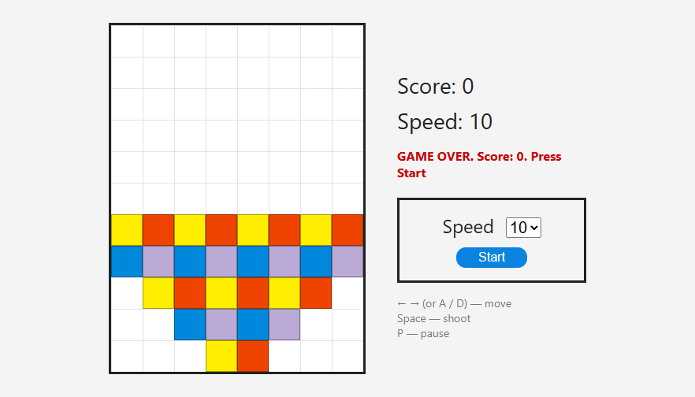

# DomBomGame

A browser game written in plain JavaScript.
Homework project for **JavaScript for Bazaarvoice — HomeTask #4 {Objects, Events, Exceptions}**.

The whole game is built with the **DOM**: every ship, the beam and the speed options are `div`/`option` elements created by JavaScript.



## How to run

Open `index.html` in a browser (double-click it, or use Live Server in VS Code). Nothing needs to be installed.

1. Choose a speed from `01` to `10` in the **Speed** list.
2. Press **Start**.
3. Destroy the alien ships before they reach the bottom row.

| Key | Action |
|-----|--------|
| `←` / `→` or `A` / `D` | move left / right |
| `Space` | shoot |
| `P` | pause / resume |

Pressing **Start** during a game starts a new game.

## Files

| File | Contents |
|------|----------|
| `index.html` | page layout: game field, scoreboard, speed form |
| `style.css` | field grid, ships, beam and explosion animations |
| `game.js` | the game: constants, error classes, ship classes, fleet, game logic, event handlers |
| `tests.html`, `game.test.js` | automated tests (open `tests.html` in a browser) |
| `screenshots/` | screenshots of the game and the tests |

## Game rules

| Requirement | Implementation |
|-------------|----------------|
| 1a. Field is 8 × 11, sizes are relative to the square, the square size is a constant | `FIELD_COLS = 8`, `FIELD_ROWS = 11`, `CELL_SIZE = 40`. Ships store their position in cells; pixels are calculated only when drawing (`col * CELL_SIZE`). The field size and the background grid are calculated from the same constants. |
| 1b. Destroy all alien ships that descend from the top | The formation is the pyramid from the mockup (8-8-6-4-2 = 28 ships), described by the `FORMATION` constant. |
| 1c. The player ship is controlled from the keyboard: left, right, shoot | `keydown` event handler. |
| 1d. All alien rows move down together at the chosen speed; the speed is chosen at the start (form on the right) | A timer moves every living alien one cell down. The speed comes from the form. |
| 1e. Points for every destroyed ship, set by a constant | `POINTS_PER_ALIEN = 100`. |
| 1f. When all aliens are destroyed the game goes on with a new fleet; every 10000 points the speed goes up | A new wave is generated immediately. `SPEED_UP_EVERY = 10000`; the speed never goes above 10. |

The game is over when an alien reaches the player's row. The fleet appears above the field and slides into it, so the player has time to react.

## Implementation

### 2a. Ship object

```
Ship (abstract)            id, col, row, size, color, isAlive
│                          render(), appendTo(), moveBy(), destroy(), validateMove()
├── PlayerShip             moves only left/right, inside the field
└── AlienShip              moves only down; moveDown()

Fleet                      creates and stores the AlienShips; moveDown(), lowestRow(), lowestInColumn()
Game                       owns the PlayerShip and the Fleet; timer, score, speed, keyboard handling
```

| OOP technique | Where |
|---------------|-------|
| Inheritance | `PlayerShip` and `AlienShip` extend `Ship`; the error classes extend `GameError` |
| Abstraction | `new Ship()` throws `TypeError`; `validateMove()` must be implemented by every subclass |
| Encapsulation | private fields (`#col`, `#row`, `#score`, …) with read-only getters; the `color` setter validates the value |
| Polymorphism | `moveBy()` is shared, the movement rules come from each subclass's `validateMove()` |
| Composition | `Game` creates its `Fleet` and `PlayerShip`; `Fleet` creates its `AlienShip`s |

### 2b. Beam

A shot draws a vertical `div.beam` from the player ship to the nearest visible alien in the same column, or to the top edge on a miss. It fades out and is removed after 150 ms.

### 2c. Speed

The speed is a discrete value from 1 to 10. The delay between steps is calculated from a time constant found experimentally:

```
delay = TIME_UNIT_MS * (MAX_SPEED + 1 - speed)      // TIME_UNIT_MS = 250
```

| Speed | 01 | 02 | 03 | 04 | 05 | 06 | 07 | 08 | 09 | 10 |
|-------|----|----|----|----|----|----|----|----|----|----|
| ms per step | 2500 | 2250 | 2000 | 1750 | 1500 | 1250 | 1000 | 750 | 500 | 250 |

### Events

| Event | Purpose |
|-------|---------|
| `submit` on the form | Start button (click or Enter). `preventDefault()` stops the page from reloading |
| `keydown` on `document` | moving, shooting, pause. Arrows and space do not scroll the page during a game |
| `visibilitychange` | switching to another tab pauses the game |
| `setInterval` / `setTimeout` | fleet descent; removing the beam and destroyed ships after their animations |

### Exceptions

Custom error classes:

```
Error
└── GameError
    ├── OutOfFieldError     the player tries to leave the field
    └── InvalidSpeedError   the speed is not an integer from 1 to 10
```

| Thrown by | Error | Caught by |
|-----------|-------|-----------|
| `PlayerShip.validateMove()` | `OutOfFieldError` | keyboard handler: the field border flashes |
| `parseSpeed()` | `InvalidSpeedError` | form handler: the message is shown in red |
| `AlienShip.validateMove()` | `GameError` | `tick()`: the game stops and shows the message |
| `Fleet.spawn()` (wrong `FORMATION`) | `GameError` | form handler on Start: the message is shown in red |
| `new Ship()`, the `color` setter, `destroy()` twice, `addScore()` with invalid points | `TypeError` / `GameError` | not caught: these are programming errors |

Only expected errors are handled (`instanceof`), everything else is re-thrown. The form handler uses `finally` to remove focus from the Start button, so the space key does not restart the game.

## Tests

Open `tests.html` in a browser. 32 tests check every requirement above: field and constants, formation, movement and field edges, keyboard handling, shooting and the beam, waves, speed up, the speed formula, the ship object (abstract class, read-only properties, setter validation, polymorphism), exceptions, pause and game over.



## Screenshots

| Start | Game over |
|-------|-----------|
|  |  |
