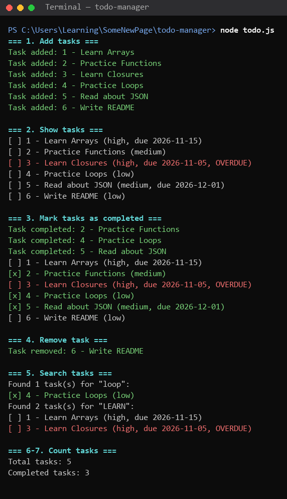
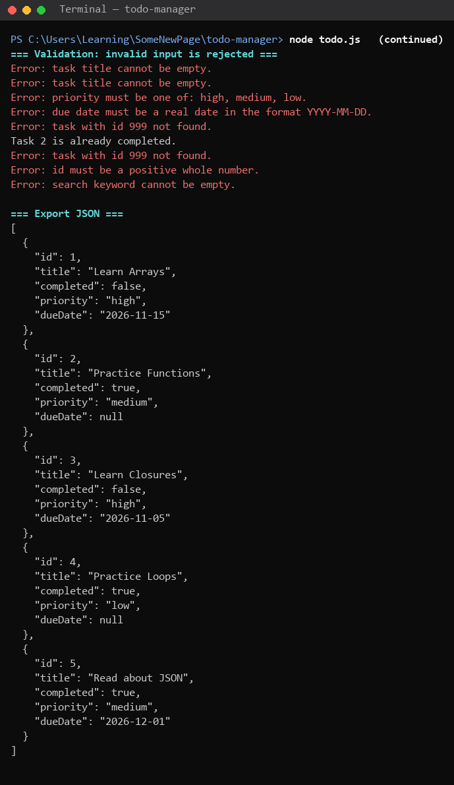
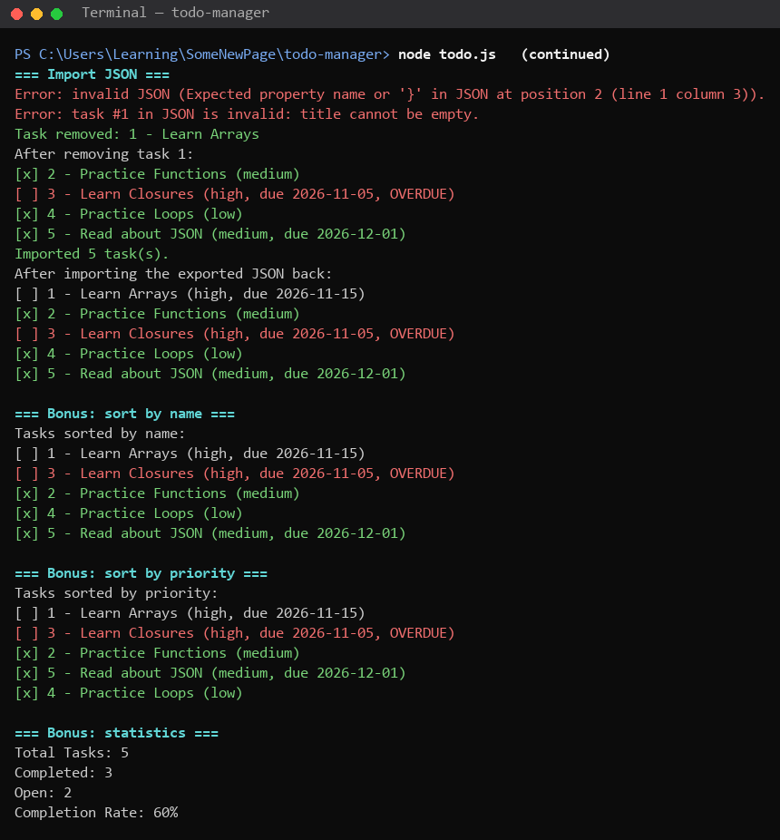
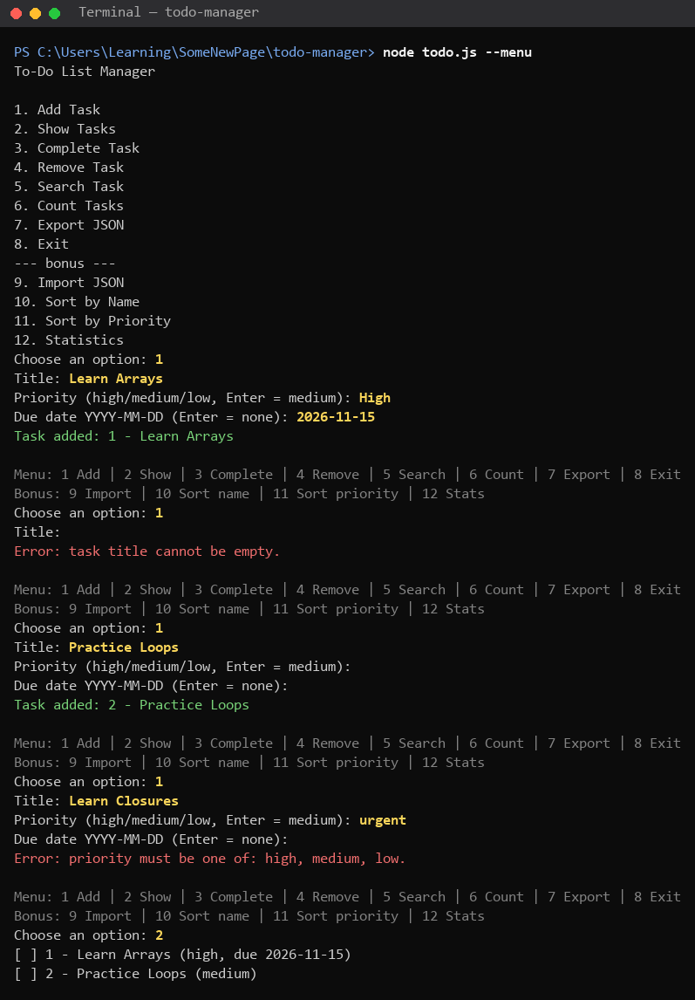
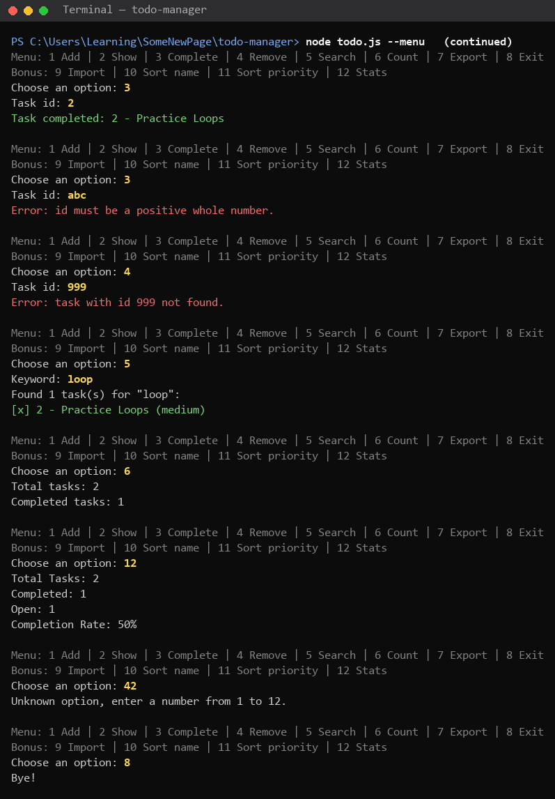
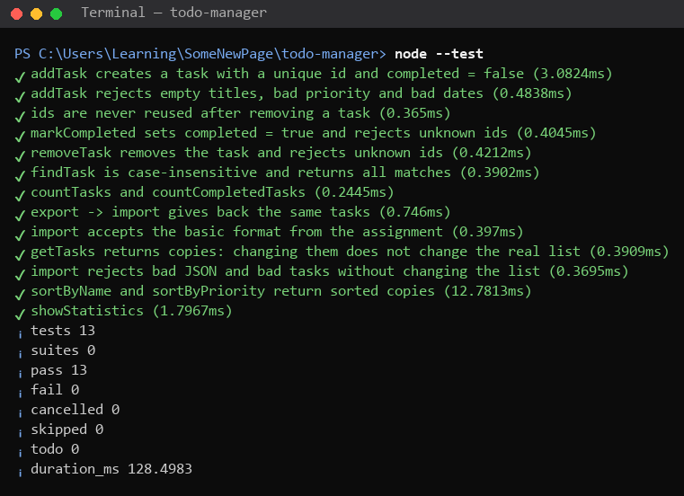

# To-Do List Manager

A console JavaScript application for managing a list of tasks.
Homework project for **SoftServe JS Session 02**: arrays, objects, loops, functions, scope, JSON and the array methods `push`, `splice`, `find`, `filter`, `map`.

## Application purpose

Keep a list of tasks in memory and work with it from the console: add tasks, mark them as done, remove them, search them, count them, and save or load the whole list as JSON.

## How to run

You need [Node.js](https://nodejs.org/) 18 or newer. No packages to install.

```bash
node todo.js          # scripted demo of every feature (6 tasks, valid and invalid input)
node todo.js --menu   # interactive menu
node --test           # run the 13 automated tests (todo.test.js)
```

## Files

| File | Contents |
|------|----------|
| `todo.js` | the application: all functions, the demo and the interactive menu |
| `todo.test.js` | automated tests (built-in `node:test`, nothing to install) |
| `screenshots/` | output of the program and the tests |

## Implemented features

### Data structure

Tasks are objects stored in an array:

```js
{ id: 1, title: 'Learn Arrays', completed: false, priority: 'high', dueDate: '2026-11-15' }
```

| Property | Type | Description |
|----------|------|-------------|
| `id` | number | Unique identifier. Generated automatically and never reused after a removal |
| `title` | string | Task description (surrounding spaces are trimmed) |
| `completed` | boolean | Completion status |
| `priority` | string | Bonus: `'high'`, `'medium'` (default) or `'low'` |
| `dueDate` | string or null | Bonus: `'YYYY-MM-DD'` or `null` |

### Core functions

| Function | What it does | Returns |
|----------|--------------|---------|
| `addTask(title, priority?, dueDate?)` | creates a task with a new id, `completed: false`, and adds it with `push` | the new task, or `null` |
| `showTasks()` | prints `[ ] 1 - Learn Arrays` / `[x] 2 - ...` using a `for...of` loop | — |
| `markCompleted(id)` | finds the task with `find` and sets `completed = true` | the task, or `null` |
| `removeTask(id)` | finds the index with `findIndex`, removes the task with `splice` and prints a confirmation | the removed task, or `null` |
| `findTask(keyword)` | case-insensitive title search with `filter` (`'loop'` finds `'Practice Loops'`) | array of matching tasks |
| `countTasks()` | prints `Total tasks: N` | number |
| `countCompletedTasks()` | counts with a classic `for` loop and prints `Completed tasks: N` | number |
| `exportTasks()` | `JSON.stringify(tasks, null, 2)` | JSON string |
| `importTasks(jsonString)` | `JSON.parse`, checks every task, then replaces the list (clean copies made with `map`) | `true` / `false` |

### Validation

- Empty or whitespace-only titles (`''`, `'   '`) and titles that are not strings are rejected.
- Unknown ids (`removeTask(999)`) and ids that are not positive whole numbers (`'abc'`, `0`, `-1`) are rejected for both `markCompleted` and `removeTask`.
- Marking an already completed task prints a message instead of doing it again.
- Empty search keywords are rejected.
- Priorities other than high / medium / low are rejected.
- Due dates must be in `YYYY-MM-DD` format and must be real dates: `2026-02-30` is rejected.
- Import rejects broken JSON, JSON that is not an array, duplicate ids and tasks with wrong fields. If anything is wrong, **the current list is not changed**. JSON in the basic format from the assignment (without `priority` / `dueDate`) also imports; missing or `null` fields get default values.
- In the menu, unknown options are reported and the program keeps running. Priority input is case-insensitive (`High` is accepted as `high`).

### Bonus challenges (all 4 levels)

1. **Priorities**: `addTask('Learn Closures', 'high')`.
2. **Due dates**: `addTask('Learn Arrays', 'high', '2026-11-15')`. Unfinished tasks whose due date has passed (compared with today's **local** date) are marked `OVERDUE`.
3. **Sorting**: `sortByName()` (A→Z, ignoring case) and `sortByPriority()` (high → medium → low; tasks with equal priority keep id order). Both return a sorted **copy**, so the original list keeps its order.
4. **Statistics**: `showStatistics()` prints Total Tasks, Completed, Open and Completion Rate in %. An empty list gives 0%, not a division by zero.

### Interactive menu

`node todo.js --menu` follows the suggested application flow (1 Add, 2 Show, 3 Complete, 4 Remove, 5 Search, 6 Count, 7 Export JSON, 8 Exit) and adds the bonus options 9 Import JSON, 10 Sort by Name, 11 Sort by Priority and 12 Statistics.

## Screenshots

| | |
|---|---|
| Demo: add, show, complete, remove, search, count |  |
| Demo: invalid input and JSON export |  |
| Demo: JSON import, sorting, statistics |  |
| Interactive menu, part 1 |  |
| Interactive menu, part 2 |  |
| Automated tests: 13 of 13 pass |  |

## Challenges encountered

- Keeping ids unique after a task is removed.
- Handling invalid JSON on import without breaking the program.
- Checking that a due date is a real date.

## Lessons learned

- Which array method fits which job: `push`, `find`, `splice`, `filter`, `map`.
- How to save and load data with `JSON.stringify` and `JSON.parse`.
- Why it is important to validate user input.
